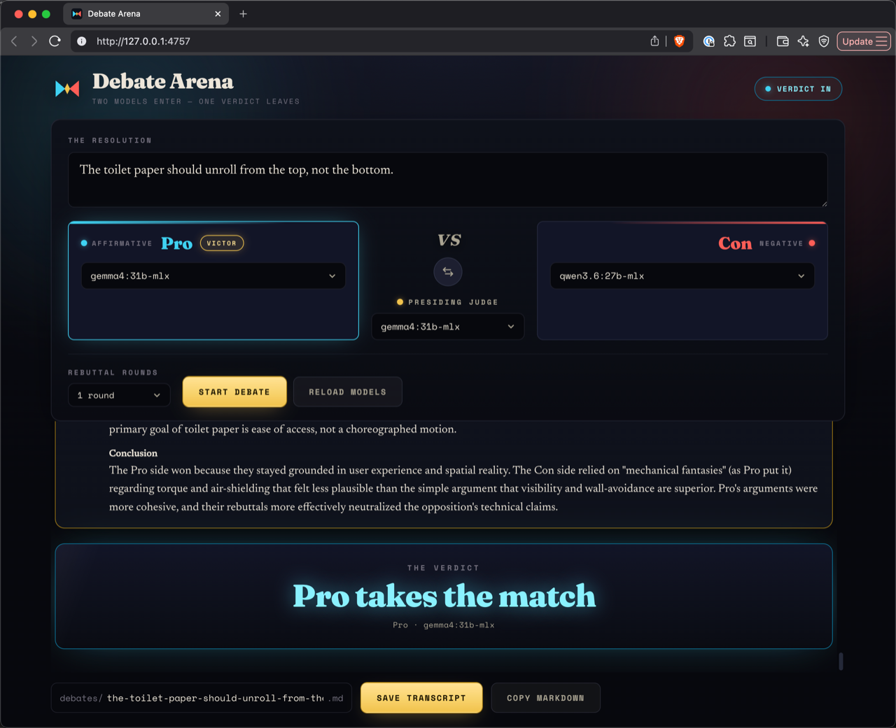
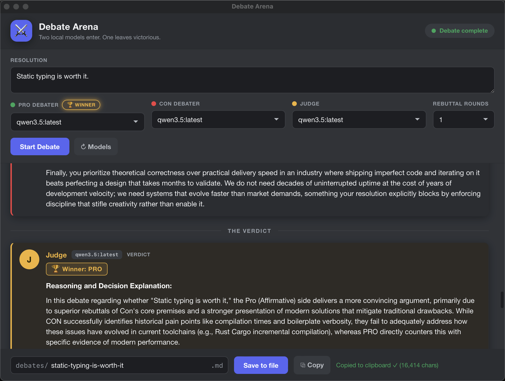
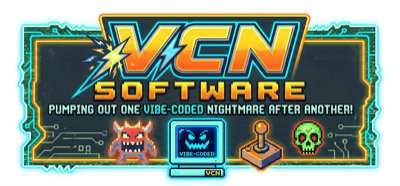

# Debate Arena

Pit models from [Ollama](https://ollama.com), Anthropic, Mistral, OpenAI,
Microsoft Foundry, or Google Gemini against each other in a structured, judged
debate.

Pick a model for each debater and a third to judge, give them a resolution, and
watch the match stream in live through opening statements, rebuttals, and
closing arguments. The judge then declares a winner and explains the verdict.

It comes in two flavors that share the same debate engine and saved-file format:

- A **standalone local app** ([`standalone/`](standalone/)) — a dependency-free
  Node server you open in your browser. Just `node server.mjs`.
- A **GitHub Copilot CLI extension** ([`.github/extensions/debates/`](.github/extensions/debates/))
  — a native desktop window driven by the
  [GitHub Copilot CLI](https://github.com/github/copilot-cli).



## Features

- **Two debaters + a judge**, with each participant independently chosen from
  any configured provider.
- **Live streaming** of every turn, token by token, with the Pro and Con corners facing off across the stage.
- **Structured format**: opening statements → configurable rebuttal rounds → closing statements → verdict.
- **A real verdict**: the judge picks a winner (or a draw) and explains why.
- **Save** the full debate to Markdown with a YAML front-matter metadata block, or **Copy** it to the clipboard.
- **Cancel** an in-progress debate at any time.
- Works with local Ollama models and the official Anthropic, Google, Mistral,
  and OpenAI SDKs, including Microsoft Foundry's OpenAI v1 endpoint.

## Requirements

- At least one usable provider:
  - [Ollama](https://ollama.com) with a model pulled (for example,
    `ollama pull llama3.2`), or
  - hosted-provider credentials, or a Microsoft Foundry endpoint and key.
- For the standalone app: [Node.js](https://nodejs.org) 18+.
- For the extension: the [GitHub Copilot CLI](https://github.com/github/copilot-cli).

## Getting started

Clone the repository, then make sure at least one provider is available. Ollama
is used automatically when it is running:

```bash
git clone https://github.com/mmacy/debate-arena.git
cd debate-arena
```

### Standalone app

```bash
cd standalone
npm install
node server.mjs
```

The server prints its URL (default <http://127.0.0.1:4757>) and opens your
browser. Enter a resolution, choose your Pro / Con / Judge models and the number
of rebuttal rounds, then click **Start debate**. See
[`standalone/README.md`](standalone/README.md) for configuration options.

### Copilot CLI extension

Start the Copilot CLI from the repository root:

```bash
copilot
```

Copilot CLI discovers the project extension under
[`.github/extensions/debates/`](.github/extensions/debates/) automatically and
installs its dependencies on first load. Run the slash command **`/debates`** to
open the Debate Arena window, then set up the match the same way.



Either way, saved debates are written to a `debates/` directory in the directory
you launched from (git-ignored by default).

## How it works

Both flavors use the shared provider runtime and debate orchestration — discover
models, stream every turn, parse the judge's verdict, and render Markdown — and
only differ in how the UI and the engine talk to each other:

- The **standalone app** is a small Node server. The browser UI calls
  the engine over `POST /api/rpc` and receives streamed turns over a
  Server-Sent Events channel (`GET /api/events`).
- The **extension** is built on the `copilot-webview` library. A native window
  talks to the extension over a WebSocket bridge.

Set provider credentials in the environment that launches Debate Arena:

| Provider | Required variable | Optional endpoint |
| --- | --- | --- |
| Ollama | _(none)_ | `OLLAMA_HOST` |
| Anthropic | `ANTHROPIC_API_KEY`, or an `ant auth login` profile | `ANTHROPIC_BASE_URL` |
| Mistral | `MISTRAL_API_KEY` | `MISTRAL_BASE_URL` |
| OpenAI | `OPENAI_API_KEY` | `OPENAI_BASE_URL` |
| Microsoft Foundry | `AZURE_FOUNDRY_ENDPOINT`; API key optional | `AZURE_FOUNDRY_RESOURCE_ID`, `AZURE_FOUNDRY_DEPLOYMENTS` |
| Google Gemini API | `GEMINI_API_KEY` or `GOOGLE_API_KEY` | — |
| Google Vertex AI | `GOOGLE_CLOUD_PROJECT`; ADC configured | `GOOGLE_CLOUD_LOCATION` (default `global`) |

For Microsoft Foundry, if `AZURE_INFERENCE_CREDENTIAL` is not set, Debate Arena
uses `DefaultAzureCredential`, which can authenticate from an existing `az
login` session. The logged-in identity must be allowed to invoke models on the
Foundry resource. `AZURE_OPENAI_API_KEY` remains available as an explicit-key
alias. Deployment discovery uses Azure Resource Manager, so the picker contains
only deployments on the selected resource rather than the full Foundry catalog.

For Gemini, create a key in [Google AI Studio](https://aistudio.google.com/apikey)
and set `GEMINI_API_KEY`. For a Google Cloud or Workspace-managed project, enable billing, run
`gcloud auth application-default login`, enable the Vertex AI API, and set
`GOOGLE_CLOUD_PROJECT`; see [`standalone/README.md`](standalone/README.md#google-gemini-setup).

The app discovers chat-capable models from every configured provider. If one
provider is unavailable, its error is shown while models from working providers
remain selectable. `DEBATE_MAX_TOKENS` optionally changes the 4,096-token
per-turn limit.

Debates involving a hosted provider send prompts and prior speeches to that
provider. Ollama requests remain local unless `OLLAMA_HOST` points elsewhere.

See [`standalone/README.md`](standalone/README.md) and
[`.github/extensions/debates/README.md`](.github/extensions/debates/README.md)
for internals, the saved-file format, and development notes.

## License

Released under [Creative Commons CC0 1.0 Universal](LICENSE) — a public-domain
dedication. You can copy, modify, and distribute this work, even for commercial
purposes, without asking permission.

---

<p align="center">
  
</p>
